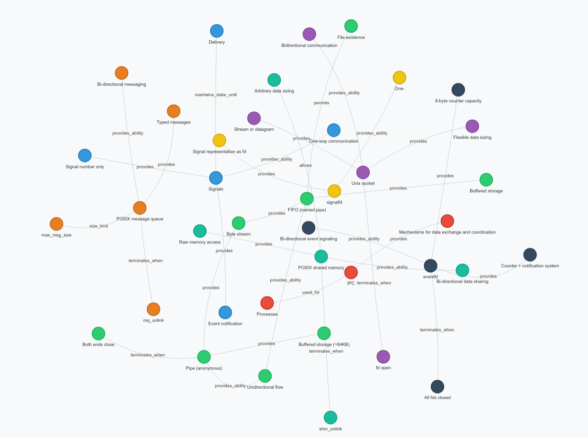

# 1. Опис предметної області, джерела даних і сформульовані запитання


**Предметна область:** Ядро Linux, як воно працює, які компоненти має і як вони взаємодіють між собою.

**Джерело даних:** [Linux Kernel Internals](https://kernel-internals.org/)

# 2. Порівняння векторного пошуку та пошуку за ключовими словами

- _Пошук за ключовими словами:_
    * "spinlock_t" — Тут дуже добре пошук за ключовими словами справився, оскільки тут потрібно було знайти що таке `spinlock_t` конкретно за цим словом
    * "kernel module is" — Тут також знайшло що треба, але виключно тому, що в документі було точно таке ж словосполучення й термін.
    * "memory management is" — А тут уже нічого не знайшло, оскільки прямих збігів нема в жодному документі.

- _Векторний пошук:_
    * "Які примітиви є для багатопроцесорності?" — Знайшло те що треба, хоч навіть текст сам був англійською мовою, а не українською, що показує що векторний пошук шукає саме за значенням документів, а не їх вмісту.
    * "spinlock_t" — Теж знайшло, але оскільки пошук за ключовими словами може шукати в малих шматках тексту, то в нього вийшло без "води" на відміну від векторного пошуку.
    * "memory management is" — А тут уже оскільки пошук проводиться за смислом, то релевантні документи знайшлися. Тут перевагу демонструє векторний пошук.

Результати вище можна пояснити тим, що пошук за ключовими словами шукає за збігом символів, а векторний пошук за близькістю N-вимірних векторів в просторі (вбудовувань), які описують текст за його смислом.

# 3. GraphRAG і VectorRAG



GraphRAG не тільки зміг передати точніше загальну суть усіх документів і відповісти на питання, а й узагалі відповісти повністю. Це можна пояснити тим, що завдяки початковому проходженню по спільнотам у графі вдалося отримати точну й дуже інформаційну "вижимку" фактів з усіх документів, на відмінну від VectorRAG, де моделі довелося працювати, по-перше, не з усіма документами, а по-друге їхній обсяг був дуже великим відносно контексного вікна моделі (128 тисяч токенів), і тому отримана відповідь обірвана.

# 4. Схема сутностей та приклади видобутих фактів, результат ручної перевірки

Схема сутностей така: є власне сутність, пов'язаний з нею факт чи об'єкт, і власне зв'язок між ними.

Код схеми такий:
```python
class Entity(BaseModel):
    name: str = Field(
        description="Назва сутності (технологія, організація, персоналія тощо)"
    )
    entity_type: str = Field(
        description="Тип сутності: Technology, Organization, Person, Location"
    )


class Fact(BaseModel):
    subject: str = Field(description="Головна сутність (Subject)")
    relation: str = Field(
        description="Зв'язок або атрибут: uses, developed_by, located_in, influences"
    )
    object: str = Field(description="Пов'язана сутність або значення (Object)")
    description: str = Field(description="Короткий контекст факту з тексту")


class ExtractionResult(BaseModel):
    facts: list[Fact] = Field(
        description="Список видобутих структурованих фактів (не менше 30 штук)"
    )
```

## Приклади фактів

```json
   {
      "subject": "IPC",
      "relation": "used_for",
      "object": "Processes",
      "description": "IPC stands for Inter-Process Communication and provides mechanisms for processes to exchange data and coordinate."
    },
    {
      "subject": "IPC",
      "relation": "provides",
      "object": "Mechanisms for data exchange and coordination",
      "description": "The fundamental purpose of IPC mechanisms."
    }
```

Ручна перевірка показала, що зв'язки між сутностями (тобто вузлами) є коректними, як і самі сутності. Але для цього потрібно було вказати напряму обов'язкові для використання зв'язки, бо інакше під час виконання лабораторної роботи до цього граф був бідний на різноманітність зв'язків.

# 5. Висновки

У висновку можна сказати, що використання графів дозволяє великим мовним моделям, особливо тим, що мають невелику кількість параметрів і контекстне вікно, краще розуміти предметну область, що пов'язана зі самим питанням, хоч і ціною більшої за обсягом роботи попередньої обробки документів.


